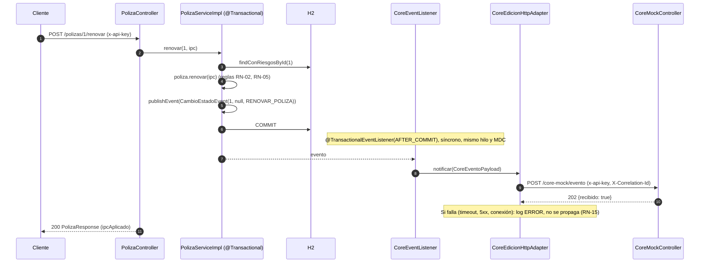

# polizas-api

API REST para gestionar pólizas de arrendamiento **Individuales** y **Colectivas** y sus riesgos: consulta, renovación por IPC, cancelación y altas y bajas de riesgos. Cada cambio de estado se notifica al CORE legado, que aquí es un mock del servicio de edición de la capa media WebLogic.
La construí como solución del **Módulo 2 (código)** de la prueba técnica para Desarrollador TI Sénior. El diseño de la plataforma completa está en el documento PDF del entregable (Módulo 1).

## Contenido

2. [Stack](#2-stack)
3. [Requisitos previos](#3-requisitos-previos)
4. [Cómo ejecutar](#4-cómo-ejecutar)
5. [Cómo probar](#5-cómo-probar)
6. [Autenticación](#6-autenticación)
7. [Endpoints](#7-endpoints)
8. [Ejemplos `curl`](#8-ejemplos-curl)
9. [Datos semilla](#9-datos-semilla)
10. [Reglas de negocio implementadas](#10-reglas-de-negocio-implementadas)
11. [Arquitectura](#11-arquitectura)
12. [Decisiones técnicas y supuestos](#12-decisiones-técnicas-y-supuestos)
13. [Qué haría en producción](#13-qué-haría-en-producción)
14. [Autor](#14-autor)

## 2. Stack

| Componente | Versión / detalle |
|---|---|
| Lenguaje | Java 17 |
| Framework | Spring Boot 3.5.16 (Web, Data JPA, Validation, Actuator) |
| Build | Maven, mediante el wrapper incluido (`mvnw` / `mvnw.cmd`) |
| Base de datos | H2 en memoria (`schema.sql` + `data.sql`; Hibernate en modo `validate`) |
| Documentación | springdoc-openapi 2.8.17 (Swagger UI) |
| Pruebas | JUnit 5, Mockito, AssertJ, Spring MockMvc, `@SpringBootTest` |
| Cobertura | JaCoCo 0.8.16 (umbral de líneas del 80 % sobre `service` y `model`) |
| Otros | Lombok (solo `@Getter` y constructores en las entidades), `RestClient` para la llamada al CORE |

## 3. Requisitos previos

- **JDK 17** instalado, con `JAVA_HOME` configurado o `java` en el `PATH`.
- **No hace falta tener Maven instalado.** El wrapper `./mvnw` descarga la versión correcta la primera vez (necesita acceso a Internet en ese momento).
- Opcional: `curl` o un cliente REST (IntelliJ HTTP Client o la extensión *REST Client* de VS Code) para usar `requests.http`.
- Opcional (extra EX-04): Docker con Docker Compose.

## 4. Cómo ejecutar

> Repositorio GitHub: pendiente de publicar. Por ahora, las instrucciones parten de la carpeta del proyecto.

```bash
cd polizas-api
./mvnw spring-boot:run          # Windows: mvnw.cmd spring-boot:run
```

La aplicación arranca en el puerto **8080** con los datos semilla ya cargados.

| Recurso | URL | Requiere API key |
|---|---|---|
| API | `http://localhost:8080` | Sí |
| Swagger UI | `http://localhost:8080/swagger-ui.html` (botón *Authorize* para el `x-api-key`) | No |
| OpenAPI (JSON) | `http://localhost:8080/v3/api-docs` | No |
| Consola H2 | `http://localhost:8080/h2-console`: JDBC URL `jdbc:h2:mem:polizasdb`, usuario `sa`, sin contraseña | No |
| Health | `http://localhost:8080/actuator/health` | No |

Otra opción es empaquetar y ejecutar el JAR:

```bash
./mvnw clean package
java -jar target/polizas-api-0.0.1-SNAPSHOT.jar
```

Variables de entorno que acepta la aplicación:

| Variable | Por defecto | Uso |
|---|---|---|
| `POLIZAS_API_KEY` | `123456` | Valor esperado en el header `x-api-key` |
| `POLIZAS_CORE_URL` | *(vacía)* | URL base del servicio de edición del CORE. Si está vacía se usa el mock local `http://localhost:{puerto}/core-mock/evento` |

### Con Docker (extra EX-04)

```bash
cd polizas-api
docker compose up --build
```

La imagen es multi-stage: compila con JDK 17 y ejecuta sobre JRE 17 con un usuario no root. Como H2 es en memoria, los datos vuelven a la semilla cada vez que se reinicia el contenedor. Las limitaciones están en [Extras](#extras).

## 5. Cómo probar

```bash
./mvnw clean verify
```

El comando ejecuta toda la suite (171 tests) y comprueba la cobertura con JaCoCo. El build **falla** si la cobertura de líneas de los paquetes `service` y `model` baja del **80 %**.

- Reporte de cobertura: `target/site/jacoco/index.html`
- Reportes de tests: `target/surefire-reports/`

| Tipo | Clases | Qué cubren |
|---|---|---|
| Dominio (unitarias) | `model/PolizaTest` | RN-01..RN-12: renovación, cancelación, recálculo de canon y prima, redondeo |
| Service (Mockito) | `service/PolizaServiceImplTest`, `RiesgoServiceImplTest`, `ConfigIpcProviderTest` | Orquestación, 404, publicación del evento CORE |
| Web (`@WebMvcTest`) | `controller/PolizaControllerTest`, `RiesgoControllerTest`, `CoreMockControllerTest` | Contratos HTTP, códigos de estado, `ProblemDetail`, `Location`, log del mock |
| Seguridad y filtros | `security/ApiKeyFilterTest`, `config/CorrelationIdFilterTest` | 401, rutas públicas, `X-Correlation-Id` |
| Repositorio (`@DataJpaTest`) | `repository/PolizaRepositoryTest` | Filtros, conteo agregado, datos semilla |
| Integración CORE | `integration/core/CoreEdicionHttpAdapterTest`, `CoreEventListenerTest` | Payload, headers, fallos sin propagar |
| Integración completa (`@SpringBootTest`) | `integration/CoreIntegracionTest`, `CoreInalcanzableIntegracionTest`, `PolizasApiApplicationTests` | Flujo de punta a punta con notificación post-commit y CORE caído (RN-15) |

## 6. Autenticación

Todos los endpoints de negocio, incluido `/core-mock/evento`, exigen este header:

```
x-api-key: 123456
```

- Si el header falta o no coincide, la API responde **401** `application/problem+json` con `codigo: API_KEY_INVALIDA`.
- El valor se configura con la variable `POLIZAS_API_KEY` (por defecto `123456`).
- Rutas públicas: `/swagger-ui.html`, `/swagger-ui/**`, `/v3/api-docs/**`, `/h2-console/**`, `/actuator/health/**` y `/favicon.ico` (lo pide el navegador automáticamente).
- La comparación se hace en tiempo constante y el valor recibido nunca se escribe en los logs.
- Cada respuesta incluye el header `X-Correlation-Id`. Si el cliente envía uno válido (`[A-Za-z0-9._-]{1,64}`), se reutiliza; si no, se genera un UUID.

## 7. Endpoints

Todos los errores siguen el formato `ProblemDetail` (RFC 7807) con las propiedades `codigo`, `timestamp` y `correlationId`.

| # | Método | Ruta | Descripción | Respuestas |
|---|---|---|---|---|
| 1 | GET | `/polizas?tipo=&estado=` | Lista las pólizas. Los filtros son opcionales y no distinguen mayúsculas (`tipo`: `INDIVIDUAL`/`COLECTIVA`; `estado`: `ACTIVA`/`RENOVADA`/`CANCELADA`) | 200 · 400 `PARAMETRO_INVALIDO` · 401 |
| 2 | GET | `/polizas/{id}/riesgos` | Lista los riesgos de una póliza (activos y cancelados) | 200 · 400 · 401 · 404 `POLIZA_NO_ENCONTRADA` |
| 3 | POST | `/polizas/{id}/renovar` | Renueva por el mismo periodo y ajusta el canon por IPC. Body opcional: `{"ipc": 0.0510}` | 200 · 400 · 401 · 404 · 409 `POLIZA_CANCELADA_NO_RENOVABLE` / `CONFLICTO_CONCURRENCIA` |
| 4 | POST | `/polizas/{id}/cancelar` | Cancela la póliza y todos sus riesgos activos. Body opcional: `{"motivo": "..."}` | 200 · 400 · 401 · 404 · 409 `POLIZA_YA_CANCELADA` |
| 5 | POST | `/polizas/{id}/riesgos` | Agrega un riesgo (solo pólizas COLECTIVAS) | 201 + `Location` · 400 `VALIDACION` · 401 · 404 · 409 `POLIZA_CANCELADA` · 422 `TIPO_POLIZA_NO_PERMITE_RIESGOS` |
| 6 | POST | `/riesgos/{id}/cancelar` | Cancela un riesgo de una póliza COLECTIVA. Body opcional: `{"motivo": "..."}` | 200 · 400 · 401 · 404 `RIESGO_NO_ENCONTRADO` · 409 `RIESGO_YA_CANCELADO` · 422 `RIESGO_INDIVIDUAL_NO_CANCELABLE` |
| 7 | POST | `/core-mock/evento` | Mock del servicio de edición del CORE. Solo registra el intento en el log | 202 · 400 `VALIDACION` · 401 |
| Extra EX-01 | GET | `/polizas/{id}` | Detalle de una póliza, con el mismo contrato que el listado | 200 · 400 · 401 · 404 `POLIZA_NO_ENCONTRADA` |

Además, cualquier endpoint puede responder 404 `RECURSO_NO_ENCONTRADO` (ruta inexistente), 405 `METODO_NO_PERMITIDO`, 415 `TIPO_CONTENIDO_NO_SOPORTADO` y 500 `ERROR_INTERNO` (sin stacktrace en el body).

Efectos laterales: los endpoints 3–6 publican un `CambioEstadoEvent` que se envía al CORE **después del commit** (operaciones `RENOVAR_POLIZA`, `CANCELAR_POLIZA`, `AGREGAR_RIESGO` y `CANCELAR_RIESGO`).

## 8. Ejemplos `curl`

Los ejemplos están **en orden** y suponen una aplicación **recién arrancada** con los datos semilla. Si se ejecutan en secuencia, cada uno devuelve la respuesta mostrada. Para volver al estado inicial basta con reiniciar la aplicación, porque H2 es en memoria. Las mismas peticiones, en el mismo orden, están en [`requests.http`](requests.http).

Los valores que dependen del momento de la ejecución (`timestamp`, `correlationId` y las fechas iguales a "hoy") se muestran con valores de ejemplo, con hoy = `2026-10-28`. En Windows conviene usar Git Bash o WSL, porque las comillas simples no funcionan en `cmd`.

### 8.1 Health (público, sin API key)

```bash
curl -s http://localhost:8080/actuator/health
```

```json
{"status":"UP"}
```

### 8.2 Listar todas las pólizas: `GET /polizas` → 200

```bash
curl -s http://localhost:8080/polizas -H 'x-api-key: 123456'
```

```json
[
  {"id":1,"numeroPoliza":"IND-2026-0001","tipo":"INDIVIDUAL","estado":"ACTIVA","tomador":"Carlos Pérez","fechaInicioVigencia":"2026-01-01","fechaFinVigencia":"2026-12-31","mesesVigencia":12,"valorCanon":1500000.00,"valorPrima":18000000.00,"cantidadRiesgosActivos":1},
  {"id":2,"numeroPoliza":"COL-2026-0001","tipo":"COLECTIVA","estado":"ACTIVA","tomador":"Inmobiliaria Los Andes SAS","fechaInicioVigencia":"2026-02-01","fechaFinVigencia":"2026-07-31","mesesVigencia":6,"valorCanon":3200000.00,"valorPrima":19200000.00,"cantidadRiesgosActivos":2},
  {"id":3,"numeroPoliza":"IND-2026-0002","tipo":"INDIVIDUAL","estado":"CANCELADA","tomador":"Laura Torres","fechaInicioVigencia":"2025-06-01","fechaFinVigencia":"2026-05-31","mesesVigencia":12,"valorCanon":950000.00,"valorPrima":11400000.00,"cantidadRiesgosActivos":0},
  {"id":4,"numeroPoliza":"COL-2026-0002","tipo":"COLECTIVA","estado":"RENOVADA","tomador":"Administración Conjunto Alameda PH","fechaInicioVigencia":"2026-03-01","fechaFinVigencia":"2027-02-28","mesesVigencia":12,"valorCanon":3150000.00,"valorPrima":37800000.00,"cantidadRiesgosActivos":2},
  {"id":5,"numeroPoliza":"IND-2026-0003","tipo":"INDIVIDUAL","estado":"ACTIVA","tomador":"Jorge Ramírez","fechaInicioVigencia":"2026-04-01","fechaFinVigencia":"2027-03-31","mesesVigencia":12,"valorCanon":2300000.00,"valorPrima":27600000.00,"cantidadRiesgosActivos":1}
]
```

### 8.3 Filtrar por tipo y estado (sin distinguir mayúsculas): `GET /polizas?tipo=colectiva&estado=activa` → 200

```bash
curl -s 'http://localhost:8080/polizas?tipo=colectiva&estado=activa' -H 'x-api-key: 123456'
```

```json
[
  {
    "id": 2,
    "numeroPoliza": "COL-2026-0001",
    "tipo": "COLECTIVA",
    "estado": "ACTIVA",
    "tomador": "Inmobiliaria Los Andes SAS",
    "fechaInicioVigencia": "2026-02-01",
    "fechaFinVigencia": "2026-07-31",
    "mesesVigencia": 6,
    "valorCanon": 3200000.00,
    "valorPrima": 19200000.00,
    "cantidadRiesgosActivos": 2
  }
]
```

### 8.4 Detalle de una póliza (extra EX-01): `GET /polizas/1` → 200

```bash
curl -s http://localhost:8080/polizas/1 -H 'x-api-key: 123456'
```

```json
{
  "id": 1,
  "numeroPoliza": "IND-2026-0001",
  "tipo": "INDIVIDUAL",
  "estado": "ACTIVA",
  "tomador": "Carlos Pérez",
  "fechaInicioVigencia": "2026-01-01",
  "fechaFinVigencia": "2026-12-31",
  "mesesVigencia": 12,
  "valorCanon": 1500000.00,
  "valorPrima": 18000000.00,
  "cantidadRiesgosActivos": 1
}
```

### 8.5 Riesgos de una póliza: `GET /polizas/2/riesgos` → 200

```bash
curl -s http://localhost:8080/polizas/2/riesgos -H 'x-api-key: 123456'
```

```json
[
  {
    "id": 10,
    "polizaId": 2,
    "descripcion": "Apto 301 - Cra 15 # 93-20, Bogotá",
    "arrendatario": "Ana Gómez",
    "arrendador": "Inversiones Andes SAS",
    "valorCanon": 2000000.00,
    "estado": "ACTIVO",
    "fechaInicio": "2026-02-01",
    "fechaCancelacion": null
  },
  {
    "id": 11,
    "polizaId": 2,
    "descripcion": "Apto 502 - Cra 15 # 93-20, Bogotá",
    "arrendatario": "Luis Martínez",
    "arrendador": "Inversiones Andes SAS",
    "valorCanon": 1200000.00,
    "estado": "ACTIVO",
    "fechaInicio": "2026-02-01",
    "fechaCancelacion": null
  }
]
```

### 8.6 Renovar con el IPC configurado (5,10 %): `POST /polizas/1/renovar` → 200

Sin body se usa `polizas.ipc.valor` = `0.0510`. El canon queda en 1.500.000 × 1,051 = 1.576.500,00 y la prima en 1.576.500,00 × 12 = 18.918.000,00. La nueva vigencia empieza el día siguiente a la fecha fin anterior.

```bash
curl -s -X POST http://localhost:8080/polizas/1/renovar -H 'x-api-key: 123456'
```

```json
{
  "id": 1,
  "numeroPoliza": "IND-2026-0001",
  "tipo": "INDIVIDUAL",
  "estado": "RENOVADA",
  "tomador": "Carlos Pérez",
  "fechaInicioVigencia": "2027-01-01",
  "fechaFinVigencia": "2027-12-31",
  "mesesVigencia": 12,
  "valorCanon": 1576500.00,
  "valorPrima": 18918000.00,
  "cantidadRiesgosActivos": 1,
  "ipcAplicado": 0.0510
}
```

En el log queda la notificación post-commit al CORE (mismo `correlationId` de la petición):

```
INFO  [<correlationId>] c.p.p.i.core.CoreEdicionHttpAdapter - [CORE-ADAPTER] Enviando evento al CORE polizaId=1, operacion=RENOVAR_POLIZA
INFO  [<correlationId>] c.p.p.controller.CoreMockController - [CORE-MOCK] Intento de envío al CORE -> evento=ACTUALIZACION, polizaId=1, operacion=RENOVAR_POLIZA, riesgoId=null, correlationId=<correlationId>
INFO  [<correlationId>] c.p.p.i.core.CoreEdicionHttpAdapter - [CORE-ADAPTER] Evento aceptado por el CORE polizaId=1, operacion=RENOVAR_POLIZA
```

### 8.7 Renovar con IPC explícito una póliza ya RENOVADA: `POST /polizas/4/renovar` → 200

Una póliza `RENOVADA` se puede volver a renovar (RN-06). Se ajusta el canon de cada riesgo activo: 1.800.000 × 1,06 = 1.908.000,00 y 1.350.000 × 1,06 = 1.431.000,00. El canon de la póliza es la suma, 3.339.000,00, y la prima es 3.339.000,00 × 12 = 40.068.000,00.

```bash
curl -s -X POST http://localhost:8080/polizas/4/renovar \
  -H 'x-api-key: 123456' -H 'Content-Type: application/json' \
  -d '{"ipc": 0.06}'
```

```json
{
  "id": 4,
  "numeroPoliza": "COL-2026-0002",
  "tipo": "COLECTIVA",
  "estado": "RENOVADA",
  "tomador": "Administración Conjunto Alameda PH",
  "fechaInicioVigencia": "2027-03-01",
  "fechaFinVigencia": "2028-02-29",
  "mesesVigencia": 12,
  "valorCanon": 3339000.00,
  "valorPrima": 40068000.00,
  "cantidadRiesgosActivos": 2,
  "ipcAplicado": 0.0600
}
```

### 8.8 Filtrar por estado: `GET /polizas?estado=RENOVADA` → 200

```bash
curl -s 'http://localhost:8080/polizas?estado=RENOVADA' -H 'x-api-key: 123456'
```

```json
[
  {"id":1,"numeroPoliza":"IND-2026-0001","tipo":"INDIVIDUAL","estado":"RENOVADA","tomador":"Carlos Pérez","fechaInicioVigencia":"2027-01-01","fechaFinVigencia":"2027-12-31","mesesVigencia":12,"valorCanon":1576500.00,"valorPrima":18918000.00,"cantidadRiesgosActivos":1},
  {"id":4,"numeroPoliza":"COL-2026-0002","tipo":"COLECTIVA","estado":"RENOVADA","tomador":"Administración Conjunto Alameda PH","fechaInicioVigencia":"2027-03-01","fechaFinVigencia":"2028-02-29","mesesVigencia":12,"valorCanon":3339000.00,"valorPrima":40068000.00,"cantidadRiesgosActivos":2}
]
```

### 8.9 Agregar un riesgo a una colectiva: `POST /polizas/2/riesgos` → 201

```bash
curl -s -i -X POST http://localhost:8080/polizas/2/riesgos \
  -H 'x-api-key: 123456' -H 'Content-Type: application/json' \
  -d '{"descripcion": "Apto 703 - Cra 15 # 93-20, Bogotá", "arrendatario": "Paula Rincón", "arrendador": "Inversiones Andes SAS", "valorCanon": 1800000.00}'
```

```
HTTP/1.1 201
Location: /riesgos/100
X-Correlation-Id: 6f1c2b9e-3a47-4d0e-9a51-2c8e7f0b4d13
Content-Type: application/json
```

```json
{
  "id": 100,
  "polizaId": 2,
  "descripcion": "Apto 703 - Cra 15 # 93-20, Bogotá",
  "arrendatario": "Paula Rincón",
  "arrendador": "Inversiones Andes SAS",
  "valorCanon": 1800000.00,
  "estado": "ACTIVO",
  "fechaInicio": "2026-10-28",
  "fechaCancelacion": null
}
```

Efecto en la póliza 2: canon 2.000.000 + 1.200.000 + 1.800.000 = 5.000.000,00 y prima × 6 = 30.000.000,00 (RN-12). Se envía `AGREGAR_RIESGO` al CORE con `riesgoId=100`.

### 8.10 Cancelar un riesgo de una colectiva: `POST /riesgos/11/cancelar` → 200

```bash
curl -s -X POST http://localhost:8080/riesgos/11/cancelar \
  -H 'x-api-key: 123456' -H 'Content-Type: application/json' \
  -d '{"motivo": "Terminación anticipada del contrato"}'
```

```json
{
  "id": 11,
  "polizaId": 2,
  "descripcion": "Apto 502 - Cra 15 # 93-20, Bogotá",
  "arrendatario": "Luis Martínez",
  "arrendador": "Inversiones Andes SAS",
  "valorCanon": 1200000.00,
  "estado": "CANCELADO",
  "fechaInicio": "2026-02-01",
  "fechaCancelacion": "2026-10-28"
}
```

Efecto en la póliza 2: canon 2.000.000 + 1.800.000 = 3.800.000,00 y prima 22.800.000,00.

### 8.11 Cancelar una póliza: `POST /polizas/2/cancelar` → 200

La cancelación también cancela los riesgos activos que quedaban (10 y 100) (RN-03). El canon y la prima se conservan como registro histórico.

```bash
curl -s -X POST http://localhost:8080/polizas/2/cancelar \
  -H 'x-api-key: 123456' -H 'Content-Type: application/json' \
  -d '{"motivo": "Terminación del contrato de administración"}'
```

```json
{
  "id": 2,
  "numeroPoliza": "COL-2026-0001",
  "tipo": "COLECTIVA",
  "estado": "CANCELADA",
  "tomador": "Inmobiliaria Los Andes SAS",
  "fechaInicioVigencia": "2026-02-01",
  "fechaFinVigencia": "2026-07-31",
  "mesesVigencia": 6,
  "valorCanon": 3800000.00,
  "valorPrima": 22800000.00,
  "cantidadRiesgosActivos": 0,
  "riesgosCancelados": 2
}
```

### 8.12 Mock del CORE: `POST /core-mock/evento` → 202

Normalmente lo invoca el adapter, pero también se puede llamar directamente. Solo deja una traza en el log y no persiste nada.

```bash
curl -s -X POST http://localhost:8080/core-mock/evento \
  -H 'x-api-key: 123456' -H 'Content-Type: application/json' \
  -d '{"evento": "ACTUALIZACION", "polizaId": 1, "operacion": "RENOVAR_POLIZA"}'
```

```json
{
  "recibido": true,
  "mensaje": "Evento registrado en logs",
  "timestamp": "2026-10-28T10:15:30-05:00"
}
```

```
INFO  [<correlationId>] c.p.p.controller.CoreMockController - [CORE-MOCK] Intento de envío al CORE -> evento=ACTUALIZACION, polizaId=1, operacion=RENOVAR_POLIZA, riesgoId=null, correlationId=<correlationId>
```

### Casos de error

Todas las respuestas de error usan `Content-Type: application/problem+json`.

### 8.13 Renovar una póliza cancelada: `POST /polizas/3/renovar` → 409

```bash
curl -s -X POST http://localhost:8080/polizas/3/renovar -H 'x-api-key: 123456'
```

```json
{
  "type": "https://api.polizas.local/errores/POLIZA_CANCELADA_NO_RENOVABLE",
  "title": "Estado inválido",
  "status": 409,
  "detail": "La poliza IND-2026-0002 esta cancelada y no se puede renovar",
  "instance": "/polizas/3/renovar",
  "codigo": "POLIZA_CANCELADA_NO_RENOVABLE",
  "timestamp": "2026-10-28T10:16:02-05:00",
  "correlationId": "0b6c8a4e-58d2-4b0f-8f3e-1d9a7c2e5f60"
}
```

### 8.14 Agregar un riesgo a una póliza individual: `POST /polizas/1/riesgos` → 422

```bash
curl -s -X POST http://localhost:8080/polizas/1/riesgos \
  -H 'x-api-key: 123456' -H 'Content-Type: application/json' \
  -d '{"descripcion": "Apto 101 - Calle 45 # 12-30, Medellín", "arrendatario": "Carlos Pérez", "arrendador": "María Restrepo", "valorCanon": 900000.00}'
```

```json
{
  "type": "https://api.polizas.local/errores/TIPO_POLIZA_NO_PERMITE_RIESGOS",
  "title": "Regla de negocio",
  "status": 422,
  "detail": "Solo las polizas colectivas permiten agregar riesgos",
  "instance": "/polizas/1/riesgos",
  "codigo": "TIPO_POLIZA_NO_PERMITE_RIESGOS",
  "timestamp": "2026-10-28T10:16:20-05:00",
  "correlationId": "4e2a9d17-7c3b-4f6a-b1e0-93d5c8a2f741"
}
```

### 8.15 Cancelar el riesgo de una póliza individual: `POST /riesgos/1/cancelar` → 422

```bash
curl -s -X POST http://localhost:8080/riesgos/1/cancelar -H 'x-api-key: 123456'
```

```json
{
  "type": "https://api.polizas.local/errores/RIESGO_INDIVIDUAL_NO_CANCELABLE",
  "title": "Regla de negocio",
  "status": 422,
  "detail": "El riesgo de una poliza individual se cancela cancelando la poliza",
  "instance": "/riesgos/1/cancelar",
  "codigo": "RIESGO_INDIVIDUAL_NO_CANCELABLE",
  "timestamp": "2026-10-28T10:16:41-05:00",
  "correlationId": "a3f07c52-1e9b-4d28-86c4-5b0e2d7f9a13"
}
```

### 8.16 Cancelar un riesgo ya cancelado: `POST /riesgos/22/cancelar` → 409

El riesgo 22 de la póliza 4 está cancelado desde la semilla.

```bash
curl -s -X POST http://localhost:8080/riesgos/22/cancelar -H 'x-api-key: 123456'
```

```json
{
  "type": "https://api.polizas.local/errores/RIESGO_YA_CANCELADO",
  "title": "Estado inválido",
  "status": 409,
  "detail": "El riesgo 22 ya se encuentra cancelado",
  "instance": "/riesgos/22/cancelar",
  "codigo": "RIESGO_YA_CANCELADO",
  "timestamp": "2026-10-28T10:17:05-05:00",
  "correlationId": "c81d4e6f-2a5b-4c90-9e37-0f6b1a8d2c54"
}
```

### 8.17 Cancelar una póliza ya cancelada: `POST /polizas/2/cancelar` → 409

```bash
curl -s -X POST http://localhost:8080/polizas/2/cancelar -H 'x-api-key: 123456'
```

```json
{
  "type": "https://api.polizas.local/errores/POLIZA_YA_CANCELADA",
  "title": "Estado inválido",
  "status": 409,
  "detail": "La poliza COL-2026-0001 ya se encuentra cancelada",
  "instance": "/polizas/2/cancelar",
  "codigo": "POLIZA_YA_CANCELADA",
  "timestamp": "2026-10-28T10:17:22-05:00",
  "correlationId": "5d9e3b70-8f14-4a6c-a2d1-7e0c4b9f3a86"
}
```

### 8.18 Agregar un riesgo a una póliza cancelada: `POST /polizas/2/riesgos` → 409

```bash
curl -s -X POST http://localhost:8080/polizas/2/riesgos \
  -H 'x-api-key: 123456' -H 'Content-Type: application/json' \
  -d '{"descripcion": "Apto 904 - Cra 15 # 93-20, Bogotá", "arrendatario": "Marta Ruiz", "arrendador": "Inversiones Andes SAS", "valorCanon": 1500000.00}'
```

```json
{
  "type": "https://api.polizas.local/errores/POLIZA_CANCELADA",
  "title": "Estado inválido",
  "status": 409,
  "detail": "No se puede agregar un riesgo a una poliza cancelada",
  "instance": "/polizas/2/riesgos",
  "codigo": "POLIZA_CANCELADA",
  "timestamp": "2026-10-28T10:17:40-05:00",
  "correlationId": "e7a2c94b-0d3f-4e18-b56a-2f8d1c7e0b39"
}
```

### 8.19 Body inválido: `POST /polizas/4/riesgos` → 400

```bash
curl -s -X POST http://localhost:8080/polizas/4/riesgos \
  -H 'x-api-key: 123456' -H 'Content-Type: application/json' \
  -d '{"descripcion": "", "arrendatario": "Camila Duarte", "arrendador": "Pedro Castillo", "valorCanon": -5}'
```

```json
{
  "type": "https://api.polizas.local/errores/VALIDACION",
  "title": "Solicitud inválida",
  "status": 400,
  "detail": "La solicitud tiene 2 error(es) de validacion",
  "instance": "/polizas/4/riesgos",
  "codigo": "VALIDACION",
  "timestamp": "2026-10-28T10:18:01-05:00",
  "correlationId": "1f6b8d2a-4c7e-49a3-8b05-d3e9a6c1f274",
  "errores": [
    {"campo": "descripcion", "mensaje": "es obligatorio"},
    {"campo": "valorCanon", "mensaje": "debe ser mayor que cero"}
  ]
}
```

### 8.20 Filtro con tipo inválido: `GET /polizas?tipo=HOGAR` → 400

```bash
curl -s 'http://localhost:8080/polizas?tipo=HOGAR' -H 'x-api-key: 123456'
```

```json
{
  "type": "https://api.polizas.local/errores/PARAMETRO_INVALIDO",
  "title": "Solicitud inválida",
  "status": 400,
  "detail": "El parametro 'tipo' tiene un valor invalido: 'HOGAR'. Valores permitidos: INDIVIDUAL, COLECTIVA",
  "instance": "/polizas",
  "codigo": "PARAMETRO_INVALIDO",
  "timestamp": "2026-10-28T10:18:15-05:00",
  "correlationId": "9c3e5a81-6b2d-4f07-a49e-8d1f0c7b2e65"
}
```

### 8.21 Póliza inexistente: `GET /polizas/999` → 404

```bash
curl -s http://localhost:8080/polizas/999 -H 'x-api-key: 123456'
```

```json
{
  "type": "https://api.polizas.local/errores/POLIZA_NO_ENCONTRADA",
  "title": "Recurso no encontrado",
  "status": 404,
  "detail": "No existe la poliza con id 999",
  "instance": "/polizas/999",
  "codigo": "POLIZA_NO_ENCONTRADA",
  "timestamp": "2026-10-28T10:18:30-05:00",
  "correlationId": "2b7d9f40-3e8a-4c51-9d6b-a0e4f2c8b173"
}
```

### 8.22 Sin API key: `GET /polizas` → 401

```bash
curl -s -i http://localhost:8080/polizas
```

```
HTTP/1.1 401
X-Correlation-Id: 7a4c1e93-5d2b-4f80-b6e7-c9f3a0d2e581
Content-Type: application/problem+json;charset=UTF-8
```

```json
{
  "type": "https://api.polizas.local/errores/API_KEY_INVALIDA",
  "title": "No autorizado",
  "status": 401,
  "detail": "El header x-api-key es obligatorio y debe tener un valor valido",
  "instance": "/polizas",
  "codigo": "API_KEY_INVALIDA",
  "timestamp": "2026-10-28T10:18:44-05:00",
  "correlationId": "7a4c1e93-5d2b-4f80-b6e7-c9f3a0d2e581"
}
```

Con una key incorrecta (`-H 'x-api-key: 000000'`) la respuesta es la misma.

## 9. Datos semilla

`src/main/resources/data.sql` carga datos ficticios cada vez que arranca la aplicación. Las identidades de `poliza` y `riesgo` se reinician en **100**, así que el primer riesgo creado por la API tiene id 100.

| Id | Número | Tipo | Estado | Tomador | Vigencia | Meses | Canon | Prima | Riesgos (id: estado) |
|---|---|---|---|---|---|---|---|---|---|
| 1 | IND-2026-0001 | INDIVIDUAL | ACTIVA | Carlos Pérez | 2026-01-01 → 2026-12-31 | 12 | 1.500.000,00 | 18.000.000,00 | 1: ACTIVO |
| 2 | COL-2026-0001 | COLECTIVA | ACTIVA | Inmobiliaria Los Andes SAS | 2026-02-01 → 2026-07-31 | 6 | 3.200.000,00 | 19.200.000,00 | 10: ACTIVO (2.000.000), 11: ACTIVO (1.200.000) |
| 3 | IND-2026-0002 | INDIVIDUAL | CANCELADA | Laura Torres | 2025-06-01 → 2026-05-31 | 12 | 950.000,00 | 11.400.000,00 | 3: CANCELADO |
| 4 | COL-2026-0002 | COLECTIVA | RENOVADA | Administración Conjunto Alameda PH | 2026-03-01 → 2027-02-28 | 12 | 3.150.000,00 | 37.800.000,00 | 20: ACTIVO (1.800.000), 21: ACTIVO (1.350.000), 22: CANCELADO (1.100.000) |
| 5 | IND-2026-0003 | INDIVIDUAL | ACTIVA | Jorge Ramírez | 2026-04-01 → 2027-03-31 | 12 | 2.300.000,00 | 27.600.000,00 | 5: ACTIVO |

Los datos son consistentes: prima = canon × meses, y el canon de una colectiva es la suma de sus riesgos **activos** (en la póliza 4 no cuenta el riesgo 22). Casos que cubre la semilla: la póliza 3 sirve para el 409 de renovación, la 1 para el 422 al agregar riesgo y la 4 para renovar una póliza ya `RENOVADA` y para cancelar un riesgo ya cancelado (22).

## 10. Reglas de negocio implementadas

| RN | Regla | Dónde | Error |
|---|---|---|---|
| RN-01 | Una póliza individual tiene exactamente 1 riesgo | `Poliza.nueva()` / `Poliza.individual()`; `Poliza.agregarRiesgo()` rechaza las individuales | 422 `POLIZA_INDIVIDUAL_UN_RIESGO` / `TIPO_POLIZA_NO_PERMITE_RIESGOS` |
| RN-02 | No se renueva una póliza cancelada | `Poliza.renovar()` | 409 `POLIZA_CANCELADA_NO_RENOVABLE` |
| RN-03 | Cancelar la póliza cancela todos sus riesgos activos | `Poliza.cancelar()` | — |
| RN-04 | Solo se agregan riesgos a pólizas COLECTIVAS | `PolizaServiceImpl.agregarRiesgo()` → `Poliza.agregarRiesgo()` | 422 `TIPO_POLIZA_NO_PERMITE_RIESGOS` |
| RN-05 | Renovación: canon × (1 + IPC) por riesgo, prima = canon × meses, vigencia desde fin + 1 día, estado `RENOVADA` | `Poliza.renovar()`, `Riesgo.ajustarCanon()`, `Dinero.ajustarPorIpc()` | — |
| RN-06 | Se renuevan las pólizas `ACTIVA` o `RENOVADA` | `Poliza.renovar()` | — |
| RN-07 | No se cancela dos veces una póliza | `Poliza.cancelar()` | 409 `POLIZA_YA_CANCELADA` |
| RN-08 | No se agrega un riesgo a una póliza cancelada | `Poliza.agregarRiesgo()` | 409 `POLIZA_CANCELADA` |
| RN-09 | No se cancela dos veces un riesgo | `Riesgo.cancelar()` | 409 `RIESGO_YA_CANCELADO` |
| RN-10 | El riesgo de una individual no se cancela por separado | `Poliza.cancelarRiesgo()` | 422 `RIESGO_INDIVIDUAL_NO_CANCELABLE` |
| RN-11 | No se cancela un riesgo de una póliza cancelada | `Poliza.cancelarRiesgo()` | 409 `RIESGO_YA_CANCELADO` |
| RN-12 | Colectiva: canon = Σ riesgos activos; individual: canon del riesgo; prima = canon × meses | `Poliza.recalcularValores()`, `Dinero` (escala 2, `HALF_UP`) | — |
| RN-13 | Póliza o riesgo inexistente | `PolizaServiceImpl.cargar()` / `listarRiesgos()`, `RiesgoServiceImpl.cancelar()` | 404 `POLIZA_NO_ENCONTRADA` / `RIESGO_NO_ENCONTRADO` |
| RN-14 | Filtros `tipo`/`estado` inválidos | `WebConfig` (conversores sin distinción de mayúsculas) + `GlobalExceptionHandler.handleTypeMismatch()` | 400 `PARAMETRO_INVALIDO` |
| RN-15 | Todo cambio de estado se notifica al CORE después del commit; si el CORE falla, solo se registra en el log | `PolizaServiceImpl` / `RiesgoServiceImpl` publican `CambioEstadoEvent`; `CoreEventListener.alConfirmarCambio()`; `CoreEdicionHttpAdapter.notificar()` | — (log `ERROR [CORE-ADAPTER]`) |
| RN-16 | Bloqueo optimista | `@Version` en `Poliza.version`; `GlobalExceptionHandler.manejarConcurrencia()` | 409 `CONFLICTO_CONCURRENCIA` |

Las reglas viven en el **agregado `Poliza`**: los services orquestan y no deciden reglas. Las transiciones de `Riesgo` son *package-private*, de modo que solo se pueden ejecutar a través de la póliza.

## 11. Arquitectura

Respeta las capas que pide el enunciado (controller → service → repository), con un **puerto de salida** hacia el CORE (`CoreEdicionPort`). Es un guiño a la arquitectura hexagonal que describo en el Módulo 1, sin llegar a la sobreingeniería.

### Paquetes

```
src/main/java/com/prueba/polizas/
├── PolizasApiApplication.java
├── controller/        PolizaController (/polizas), RiesgoController (/riesgos),
│                      CoreMockController (/core-mock/evento)
├── service/           PolizaService(+Impl), RiesgoService(+Impl), IpcProvider + ConfigIpcProvider,
│                      PolizaConConteo, ResultadoRenovacion, ResultadoCancelacion
├── model/             Poliza (agregado raíz), Riesgo, DatosRiesgo, Dinero
│   └── enums/         TipoPoliza, EstadoPoliza, EstadoRiesgo, OperacionCore
├── repository/        PolizaRepository, RiesgoRepository, ConteoRiesgos (proyección del conteo)
├── dto/
│   ├── request/       AgregarRiesgoRequest, CancelacionRequest, RenovacionRequest, CoreEventoRequest
│   └── response/      PolizaResponse, RiesgoResponse, CoreEventoResponse
├── mapper/            PolizaMapper (manual, funciones puras)
├── integration/core/  CoreEdicionPort, CoreEdicionHttpAdapter, CoreEventListener,
│                      CambioEstadoEvent, CoreEventoPayload
├── security/          ApiKeyFilter
├── config/            PolizasProperties, WebConfig, RestClientConfig, OpenApiConfig, CorrelationIdFilter
└── exception/         CodigoError, NegocioException, ReglaNegocioException (422),
                       EstadoInvalidoException (409), RecursoNoEncontradoException (404),
                       ErrorCampo, ProblemDetailFactory, GlobalExceptionHandler
```

### Capas y dependencias

```
 HTTP ──► CorrelationIdFilter ──► ApiKeyFilter ──► Controller ──► Service ──► Repository ──► H2
                                                      │  DTO/Mapper   │  @Transactional
                                                      │               ├──► model (Poliza/Riesgo: reglas RN)
                                                      │               └──► ApplicationEventPublisher
                                                      │                         │ CambioEstadoEvent
                                          GlobalExceptionHandler                ▼ (AFTER_COMMIT)
                                          (ProblemDetail)            CoreEventListener ──► CoreEdicionPort
                                                                                              │
                                                                               CoreEdicionHttpAdapter
                                                                                              │ HTTP POST
                                                                                              ▼
                                                                     /core-mock/evento (o POLIZAS_CORE_URL)
```

### Flujo post-commit hacia el CORE



Si el diagrama Mermaid no se renderiza, la secuencia en texto es esta:

```
Controller → Service (@Transactional)
   → repository.findConRiesgosById → poliza.renovar(ipc) → publishEvent(CambioEstadoEvent)
COMMIT
   → CoreEventListener (@TransactionalEventListener AFTER_COMMIT)
        → CoreEdicionPort.notificar(payload)
             → CoreEdicionHttpAdapter: POST {POLIZAS_CORE_URL | http://localhost:{puerto}}/core-mock/evento
                  headers: x-api-key, X-Correlation-Id
                  body: {"evento":"ACTUALIZACION","polizaId":1,"operacion":"RENOVAR_POLIZA","riesgoId":null}
             → éxito: log INFO; error: log ERROR (no propaga)
```

**¿Por qué el adapter llama al mock por HTTP y no invoca el controller directamente?** Porque así el desacople es real. El service solo conoce el puerto `CoreEdicionPort`, y el adapter hace una llamada de red con los mismos headers, timeouts y manejo de errores que tendría contra el servicio WebLogic. Para pasar a producción basta con definir `POLIZAS_CORE_URL`, sin tocar código. Además, los tests de integración pueden comprobar el comportamiento cuando el CORE no está disponible (`CoreInalcanzableIntegracionTest`).

**¿Por qué después del commit?** Para no avisar al CORE de un cambio que luego podría revertirse. El costo es que, si el CORE falla, la operación local queda confirmada y el evento se pierde (solo queda en el log). En producción esto se resuelve con *outbox* (ver la sección 13).

## 12. Decisiones técnicas y supuestos

### 12.1 Supuestos de negocio (S1–S11)

| ID | Supuesto |
|---|---|
| S1 | El IPC es configurable (`polizas.ipc.valor`). Por defecto vale `0.0510` = **5,10 %**, el IPC de Colombia al cierre de 2025 según el DANE (publicado en enero de 2026). Verifiqué el valor antes de la entrega. También se puede enviar un IPC explícito en el body de `renovar`. En producción se obtendría de un servicio o tabla de índices (`IpcProvider` es el punto de extensión). |
| S2 | Una póliza se puede renovar si está `ACTIVA` o `RENOVADA`, nunca si está `CANCELADA`. |
| S3 | La renovación empieza el día siguiente a la fecha fin anterior y dura los mismos meses (por ejemplo, 2026-01-01→2026-12-31 se renueva a 2027-01-01→2027-12-31). |
| S4 | Estados de póliza: `ACTIVA`, `RENOVADA`, `CANCELADA`. Estados de riesgo: `ACTIVO`, `CANCELADO`. |
| S5 | Cancelar una póliza ya cancelada → 409. Cancelar un riesgo ya cancelado → 409. |
| S6 | En las pólizas individuales el riesgo no se cancela por separado (se cancela con la póliza) → 422. |
| S7 | Cancelar el último riesgo activo de una colectiva **no** cancela la póliza; se registra un `WARN`. Es una decisión de negocio que habría que validar. |
| S8 | No se puede agregar un riesgo a una póliza cancelada → 409. |
| S9 | Al renovar, los riesgos activos se mantienen y el canon de cada uno también se ajusta por IPC. |
| S10 | La notificación al CORE ocurre **después del commit** de la transacción local. Si falla, se registra el error (en producción: outbox + reintentos). |
| S11 | Colectiva: canon de la póliza = suma de los cánones de sus riesgos activos, y la prima se recalcula al agregar o cancelar riesgos. Individual: canon de la póliza = canon de su único riesgo. |

### 12.2 Decisiones técnicas

| Decisión | Elegí | Alternativa descartada y por qué |
|---|---|---|
| Seguridad | `ApiKeyFilter` (`OncePerRequestFilter`) sencillo, con comparación en tiempo constante y rutas públicas por `PathPattern` | Spring Security: para una API key estática añade configuración y superficie sin aportar valor. En producción la autenticación (OAuth2/JWT) iría en el API Gateway |
| Notificación al CORE | Listener **síncrono** `@TransactionalEventListener(AFTER_COMMIT)` en el hilo de la petición | Outbox + broker: es la solución correcta en producción (sección 13), pero para la prueba el listener es simple, determinístico en los tests y conserva el `correlationId` del MDC |
| Puerto + adapter HTTP | `CoreEdicionPort` + `CoreEdicionHttpAdapter` (`RestClient` con timeouts) | Llamar al mock directamente: ocultaría el acoplamiento de red y no permitiría probar fallos reales |
| Redondeo | `BigDecimal`, escala 2 y `HALF_UP` **por riesgo**. La colectiva suma los valores ya redondeados | Redondear solo el total: el canon de la póliza podría no coincidir con la suma de sus riesgos |
| IPC | Configurable (`polizas.ipc.valor`) detrás de `IpcProvider`, con valor explícito opcional en el body | Valor fijo en el código: obligaría a desplegar cada año |
| Dinero | Nunca `double`/`float` | — |
| Esquema | `schema.sql` explícito (CHECKs e índices) + `ddl-auto: validate` | `ddl-auto: create`: oculta el DDL real y los índices |
| Errores | `ProblemDetail` (RFC 7807) con `codigo` estable para el front | Formato propio: no sigue el estándar |
| Mapeo | `PolizaMapper` manual | MapStruct: más dependencias para pocos DTOs |
| Concurrencia | `@Version` (bloqueo optimista) → 409 | Bloqueo pesimista: reduce el throughput sin necesidad |

### Supuestos

- Java 17 en lugar de 21 por estándar del equipo; Spring Boot 3.5.16.
- **Redondeo (RN-12, S11):** dinero en `BigDecimal` con escala 2 y `HALF_UP`. En la renovación se redondea el canon de **cada riesgo** y la póliza colectiva suma esos valores ya redondeados; la prima es `canon × meses`, también redondeada a 2 decimales.
- **RN-01 en la construcción:** las pólizas se crean con las fábricas `Poliza.individual(...)`, `Poliza.colectiva(...)` o `Poliza.nueva(...)`. Una individual con un número de riesgos distinto de 1 lanza `POLIZA_INDIVIDUAL_UN_RIESGO`. Si se llama a `agregarRiesgo` sobre una individual, responde `TIPO_POLIZA_NO_PERMITE_RIESGOS` (RN-04), ya que el tipo se valida antes que el estado.
- **Precedencia de errores al agregar riesgo:** 404 `POLIZA_NO_ENCONTRADA` → 422 `TIPO_POLIZA_NO_PERMITE_RIESGOS` → 409 `POLIZA_CANCELADA` (p. ej. la póliza 3, individual y cancelada, responde 422).
- **Colectiva sin riesgos activos:** se permite (S7). Su canon y su prima quedan en 0,00 hasta que se agregue un riesgo.
- **Fecha de inicio de riesgos:** los riesgos iniciales empiezan en la fecha de inicio de vigencia de la póliza. Un riesgo agregado después empieza **hoy**, o en la fecha de inicio de vigencia si esta es posterior.
- **Cancelación de póliza:** se cancelan todos sus riesgos activos con fecha de hoy y el motivo recibido. El canon y la prima se **conservan** como registro histórico, sin recalcular a 0.
- **Cancelación de riesgo:** el orden de las validaciones es pertenencia a la póliza (404 `RIESGO_NO_ENCONTRADO`), póliza cancelada (409 `RIESGO_YA_CANCELADO`, RN-11), póliza individual (422, RN-10) y riesgo ya cancelado (409, RN-09).
- **Agregado:** las transiciones de `Riesgo` (`cancelar`, `ajustarCanon`) son *package-private*. Solo se ejecutan a través de `Poliza`, para que los recálculos del agregado siempre se hagan.
- **Esquema:** lo crea `schema.sql` (con CHECKs de enums, índices `idx_poliza_tipo_estado` e `idx_riesgo_poliza_estado`) y Hibernate solo lo valida (`ddl-auto: validate`). `data.sql` carga la semilla de 02d y reinicia las identidades en 100.
- **Ids de la semilla:** pólizas 1–5. Cada riesgo de una póliza individual usa el mismo id que su póliza (1, 3, 5). Los riesgos de colectivas usan rangos propios: póliza 2 → 10, 11 (coincide con el ejemplo de 02c) y póliza 4 → 20, 21, 22 (el 22 está cancelado).
- **Conteo de riesgos activos sin N+1:** `GET /polizas` usa una consulta agregada (`RiesgoRepository.contarActivosPorPoliza`) en lugar de cargar la colección de cada póliza.
- **Resultados de los services:** como `open-in-view` está desactivado, los services devuelven todo lo que necesita la respuesta ya resuelto dentro de la transacción: `PolizaConConteo(poliza, cantidadRiesgosActivos)` en el listado, `ResultadoRenovacion(poliza, cantidadRiesgosActivos, ipcAplicado)` y `ResultadoCancelacion(poliza, cantidadRiesgosActivos, riesgosCancelados)`. Agregar y cancelar riesgo devuelven la entidad `Riesgo`, que ya tiene su id.
- **IPC en la renovación:** por defecto se usa `polizas.ipc.valor` a través de `IpcProvider`. El service también acepta un IPC explícito (`renovar(id, ipc)`, para el body opcional `{ "ipc": ... }` de 02c). Si es `null`, se usa el IPC vigente. El rango `0 ≤ ipc ≤ 1` se valida en el DTO de entrada.
- **Evento CORE:** se publica `CambioEstadoEvent(polizaId, riesgoId, operacion)` solo cuando la operación de dominio termina bien. `riesgoId` es `null` en `RENOVAR_POLIZA` y `CANCELAR_POLIZA`.
- **Cancelación de riesgo:** el riesgo se busca por id (404 `RIESGO_NO_ENCONTRADO`) y la regla se aplica a través de su póliza (`poliza.cancelarRiesgo`). Si una colectiva se queda sin riesgos activos, se registra un `WARN` y la póliza no se cancela (S7).
- **Motivo de cancelación:** es opcional. Si no se envía, se guarda como `null`.
- **Versionamiento:** las rutas son exactamente las del enunciado, sin prefijo (`/polizas/...`, `/riesgos/...`). No se exponen alias `/v1` para no duplicar el contrato; la estrategia de versionamiento se explica en el Módulo 1 (ver *Qué haría en producción*).
- **Filtros `tipo`/`estado` case-insensitive:** `?tipo=colectiva` equivale a `COLECTIVA`. Un valor vacío (`?tipo=`) cuenta como sin filtro. Un valor desconocido responde 400 `PARAMETRO_INVALIDO` con la lista de valores permitidos. Un `id` no numérico en la ruta también responde 400 `PARAMETRO_INVALIDO`.
- **Campos condicionales en `PolizaResponse`:** un único record. `ipcAplicado` solo aparece en la respuesta de `renovar` y `riesgosCancelados` solo en la de `cancelar` (`@JsonInclude(NON_NULL)` en esos dos campos). El resto de campos, incluido `tomador`, aparece siempre. En `RiesgoResponse`, `fechaCancelacion` se serializa como `null` mientras el riesgo esté activo.
- **`ipcAplicado`** se expone con al menos 4 decimales (`0.0510`), sin redondear un IPC más preciso.
- **`Location` al agregar riesgo:** `201 Created` con `Location: /riesgos/{idRiesgo}`, una ruta relativa. No existe un `GET /riesgos/{id}` porque el enunciado no lo pide. El `Location` identifica el recurso creado.
- **Bodies opcionales:** `renovar`, `cancelar` póliza y `cancelar` riesgo aceptan la petición sin body. Cuando llega un body, se valida: `ipc` entre 0 y 1 y `motivo` de máximo 300 caracteres. Al agregar un riesgo, los textos se guardan sin espacios al inicio ni al final.
- **Errores:** todos los errores salen como `application/problem+json` con `type` (`https://api.polizas.local/errores/{CODIGO}`), `title` (según la tabla de 02c), `status`, `detail`, `instance` (URI de la petición), `codigo`, `timestamp` (hora de Bogotá, `-05:00`, en segundos) y `correlationId`. Un JSON malformado responde 400 `VALIDACION`. Hay tres códigos más fuera de 02b: `RECURSO_NO_ENCONTRADO` (404, ruta inexistente), `METODO_NO_PERMITIDO` (405) y `TIPO_CONTENIDO_NO_SOPORTADO` (415). Un error no controlado responde 500 `ERROR_INTERNO` sin stacktrace en el body. El stacktrace se registra en el log con nivel ERROR.
- **Correlation id:** `CorrelationIdFilter` reutiliza el header `X-Correlation-Id` si cumple `[A-Za-z0-9._-]{1,64}`, para evitar inyección en logs. Si no lo cumple, genera un UUID. El valor va al MDC (`correlationId`) y al header de la respuesta.
- **Seguridad:** `ApiKeyFilter` es un `OncePerRequestFilter` simple, sin Spring Security. Se ejecuta después de `CorrelationIdFilter` (los dos son `@Component` con `@Order` explícito, así no se registran dos veces). Las exclusiones se evalúan con `PathPattern`, y `/actuator/health/**` también cubre `/actuator/health`. El valor de la key recibida nunca se registra en el log.
- **Mock del CORE (`POST /core-mock/evento`):** solo registra en log (`[CORE-MOCK] ... correlationId=...`) y responde 202 `{recibido, mensaje, timestamp}` (timestamp con zona America/Bogota). No persiste nada. También está protegido por la API key.
- **URL del CORE:** `polizas.core.url` toma `POLIZAS_CORE_URL` y por defecto queda **vacía**. Vacía significa "mock local": el adapter arma `http://localhost:{local.server.port}{polizas.core.path}` **en cada envío**, leyendo el puerto real del servidor desde el `Environment` (si no existe, usa `server.port` o 8080). Así funciona con `spring-boot:run` (8080) y con tests `RANDOM_PORT`, donde `${server.port}` vale 0. Cuando exista el servicio WebLogic, basta con definir `POLIZAS_CORE_URL`. El adapter llama al mock por HTTP, y no directamente, para mostrar el desacople real.
- **Notificación al CORE:** `CoreEventListener` (`@TransactionalEventListener(AFTER_COMMIT)`) es **síncrono** y corre en el hilo de la petición, por lo que el MDC conserva el `correlationId`. El adapter lo propaga como `X-Correlation-Id` junto con la API key. El `RestClient` usa `SimpleClientHttpRequestFactory` con timeouts de conexión y lectura de `polizas.core.timeout-ms`.
- **Fallos del CORE (RN-15):** el adapter captura cualquier `RuntimeException` y registra `ERROR [CORE-ADAPTER] Falló envío al CORE ...` sin relanzarla. El listener también captura por si otra implementación del puerto lanza. La operación local ya está confirmada y la respuesta HTTP no depende del CORE. No hay reintentos (en producción: outbox + broker, Módulo 1; Resilience4j es el extra EX-06).

### Extras

Lo que va más allá del enunciado está marcado como **extra**:

- **Java 17 en lugar de 21** (no es un extra, es una decisión). Usé Java 17 porque es el estándar del equipo. El código no usa ninguna característica de versiones posteriores a la 17.
- **EX-01 (extra): `GET /polizas/{id}`**, para el consumo del front de pólizas individuales (enunciado, Módulo 1 → API, punto 2). Devuelve el mismo `PolizaResponse` de RF-01, con `cantidadRiesgosActivos`, pero sin la lista de riesgos, que se consulta en `GET /polizas/{id}/riesgos`. Si la póliza no existe responde 404 `POLIZA_NO_ENCONTRADA`; si el id no es numérico, 400 `PARAMETRO_INVALIDO`. Es solo de lectura y no emite evento al CORE.
- **EX-04 (extra): Dockerfile multi-stage + `docker-compose.yml`.** Compila con `eclipse-temurin:17-jdk` y ejecuta sobre `eclipse-temurin:17-jre` con un usuario no root (`app`). No tiene `HEALTHCHECK` porque la JRE base no trae `curl` ni `wget`; el orquestador debe usar `/actuator/health`. Como H2 es en memoria, los datos se reinician con el contenedor. Variables: `POLIZAS_API_KEY` (por defecto `123456`) y `POLIZAS_CORE_URL` (vacía = mock local; se puede añadir en `environment` del compose). Se ejecuta con `docker compose up --build`. **Nota:** no pude verificar la construcción de la imagen en mi entorno de desarrollo, porque Docker Desktop tenía el almacenamiento en solo lectura.
- **Extras transversales:** `X-Correlation-Id` de punta a punta (filtro → MDC → logs → header hacia el CORE), Swagger con el esquema `x-api-key` (botón *Authorize*), conteo de riesgos activos sin N+1 y CHECKs e índices en `schema.sql`.

## 13. Qué haría en producción

- **Outbox + Kafka:** guardaría el evento en una tabla `outbox_evento` dentro de la misma transacción que el cambio de estado. Un *relay* (o Debezium/CDC) lo publicaría en Kafka y un consumidor idempotente llamaría al servicio WebLogic. Así ningún evento se pierde aunque el CORE esté caído, y la entrega es *at-least-once* con deduplicación por id de evento.
- **Resilience4j** en el adapter del CORE: *timeout*, reintentos con *backoff* exponencial y *jitter*, *circuit breaker* y *bulkhead*, con métricas expuestas en Actuator.
- **Oracle o PostgreSQL + Flyway:** migraciones versionadas en lugar de `schema.sql`, pool HikariCP ajustado e índices revisados con el plan de ejecución (Módulo 3).
- **OAuth2/JWT en el API Gateway:** el gateway valida los tokens (*client credentials* para sistemas, *authorization code* + PKCE para el front) y aplica *rate limiting*. El servicio solo valida *scopes* con Spring Security Resource Server. Los secretos estarían en un vault, no en variables planas.
- **Observabilidad con OpenTelemetry:** trazas distribuidas (W3C `traceparent` en lugar del `X-Correlation-Id` propio), métricas Micrometer → Prometheus/Grafana, logs JSON centralizados (ELK/Loki) y alertas sobre la tasa de errores del CORE y el tamaño del outbox.
- **Paginación y ordenamiento** en `GET /polizas` y `GET /polizas/{id}/riesgos` (`page`, `size`, `sort`), con un límite máximo de `size`.
- **Versionamiento `/v1`** como ruta oficial, con política de *deprecation* (headers `Deprecation`/`Sunset`) y contratos OpenAPI publicados y versionados.
- **CI/CD:** pipeline con build, tests, cobertura, análisis estático (Sonar), escaneo de dependencias e imagen (OWASP/Trivy), y despliegue por ambientes con *health checks* y *rollback*.
- **Renovación automática:** un job programado (ShedLock o Spring Batch) que renueve las pólizas próximas a vencer con el IPC vigente obtenido de un servicio de índices, y que emita los eventos de notificación (correo/SMS).
- **Auditoría:** historial de cambios de estado (quién, cuándo, motivo), por ejemplo con Hibernate Envers o una tabla de eventos.

## 14. Autor

**Santiago Arias**. Prueba técnica para Desarrollador TI Sénior.
